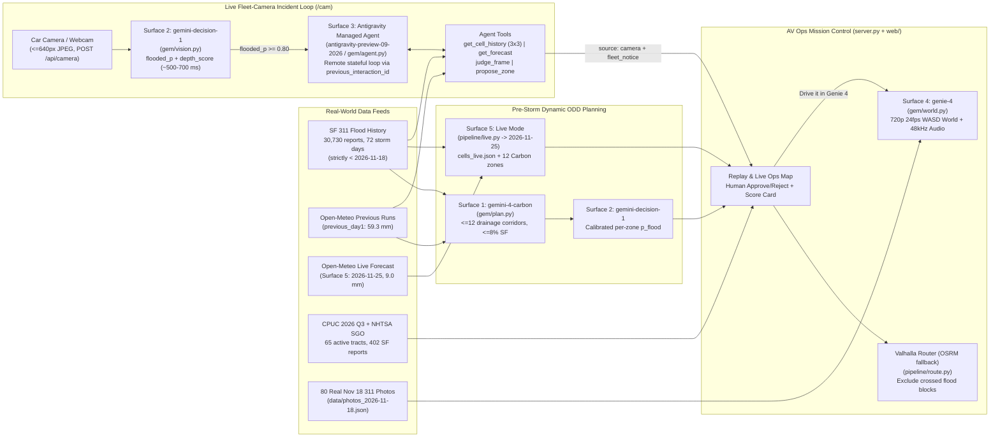

# Robotaxi Flood Pull-Back

> **Pre-storm Dynamic ODD planning + real-time fleet-camera flood closure for autonomous vehicle operations.**  
> *"Tell a robotaxi fleet manager, the night before, which streets to close and when—then the first car that sees water closes the street for every other car."*
>
> **Gemini 4 NYC Hackathon** · November 21, 2026 · **Track:** Antigravity Managed Agents ($5k Prize) + Full 5-Surface Gemini 4 Stack

---

## 1. Elevator Pitch & Problem Statement

On **Wednesday, November 18, 2026**, San Francisco experienced a historic atmospheric river:
- **Nov 17 (24 h earlier):** The California DMV restricted Waymo from state freeways following construction-zone incidents—forcing **100% of Waymo SF trips onto surface arterials**.
- **Nov 18 rainfall records:** Downtown SF recorded **2.11"** before noon (wettest pre-noon in **76 years**, breaking 1950) and **2.28"** by mid-afternoon (breaking the **108-year** Nov 18 daily record since 1918; >2.60" storm total).
- **Record street flooding:** Residents logged **778 street-flooding reports** to SF 311 (`vw6y-z8j6`)—the highest single-day total on record, with **384 reports in the 10:00 AM hour alone** (559 between 10 AM and 12 PM).
- **23-hour citywide Waymo blackout:** After 5+ vehicles stalled in standing water (including **Oak & Cole**, **Fell & Masonic**, and **Bayshore & Industrial**), Waymo paused commercial service across San Francisco, the Peninsula, and South Bay from **~11:00 AM Nov 18 to ~10:00 AM Nov 19** (across a fleet running ~315,000 paid CA trips/week and ~3,000 vehicles nationwide).
- **Why static map patches failed:** Six months earlier (Apr/May 2026), Waymo voluntarily recalled **3,791 vehicles** after an unoccupied car drove into floodwater on the I-35 frontage road near Salado Creek in San Antonio and shipped static flood-zone map patches—yet still suffered a 23-hour SF shutdown because static maps lack storm-specific rain thresholds, hourly timing, and live detection of clogged-drain flash floods.
- **Public regulatory ground truth (`data/waymo_stats.json`, `data/waymo_sf.geojson`):**
  - **CPUC Waymo 2026 Q3 filing** (ended Sep 30, 2026—strictly pre-Nov-18; trip/stoppage locations are redacted, so collision tracts serve as the public operating-footprint proxy): **65 of 244 SF census tracts (27%)** recorded Waymo collisions (94 Q3 collisions), and **374 of 778 Nov 18 floods (48.1%)** occurred inside those 65 Waymo-active tracts.
  - **NHTSA SGO (Jun 2025 – Oct 2026):** **402** Waymo SF crash reports, **16 in rain**.

**Robotaxi Flood Pull-Back** replaces binary citywide shutdowns with a **Dynamic ODD Envelope (ISO 34503)**:
1. **Night-before Dynamic ODD plan (`gemini-4-carbon` + `gemini-decision-1`):** Digests 30,730 pre-storm SF 311 flood reports (72 storm days, 2008–2026) and the night-before rain forecast to propose ≤12 named drainage corridors capped at **8.0% of SF area**, each citing exact historical `storm_days` and a calibrated `p_flood`, with human-in-the-loop ops approval.
2. **Fleet-as-Sensor live closure (`gemini-decision-1` + `antigravity-preview-09-2026`):** When any vehicle camera sees standing water outside pre-planned zones, Decision 1 scores the frame in sub-second latency; if `flooded_p >= 0.80`, an Antigravity Managed Agent inspects 3×3 neighborhood flood memory + live rain trajectory, sizes a local basin closure, emits a Fleet Dispatch Notice, and triggers immediate Valhalla rerouting for the rest of the fleet.
3. **Interactive visual verification (`genie-4`):** Turns a single real 311 resident photo into a live, 720p, 24 fps WASD-steerable storm world with 48 kHz stereo audio (explicitly labeled as a visual illustration, not a depth measurement).
4. **Live forward operations (`2026-11-25`):** Runs the exact same pipeline on the real Open-Meteo forecast for next Wednesday, Thanksgiving Eve (9.0 mm), with 12 Carbon zones awaiting ops approval today.

---

## 2. System Architecture (All 5 Gemini 4 Surfaces)



---

## 3. Why Antigravity Managed Agents ($5k Prize Track)

A naive `if flooded: block_cell()` script fails in real AV operations: blocking a single 165 m GPS cell leaves adjacent flooded cross-streets open, while blocking a fixed wide radius kills dry hillside arterials and collapses fleet ETA.

`gem/agent.py` uses **Antigravity Managed Agents (`antigravity-preview-09-2026`)** on the `v1beta` Interactions API to perform stateful, evidence-grounded incident response:

- **Remote stateful multi-turn orchestration:** Calls `beta.interactions.create(agent="antigravity-preview-09-2026", environment="remote", agent_config={"type": "antigravity", "model": "gemini-4-hydrogen", "max_total_tokens": 50000}, tools=active_tools)` and chains turns remotely via `previous_interaction_id` whenever `status == "requires_action"`, executing parallel function calls (`get_cell_history` + `get_forecast`, plus optional `judge_frame` when a local image path is supplied) before finalizing via `propose_zone`. Completes end-to-end in **~19–24 s** with zero unhandled errors (and stamps `agent_engine` + `interaction_id` on the emitted zone for UI provenance; `gemini-4-carbon` tool-calling is retained solely as an unreachable-API resilience fallback).
- **Dynamic 3×3 basin expansion:** `get_cell_history(cell)` returns the target cell plus all 8 immediate neighbors sorted by `(n_storm_days, n_reports)`. The agent expands the closure only into adjacent cells with proven drainage history (`n_storm_days >= 2` or `n_reports >= 5`), hard-bounded by `propose_zone` to **Chebyshev distance ≤ 2** from `target_cell`—covering the local flooded basin (typically 2–5 cells) without over-blocking dry blocks.
- **Rain-decay duration windowing:** `get_forecast(date)` provides hourly precipitation, 24 h total, peak 6 h rolling sum, and `latest_update`. The agent sets closure duration (`3–6 h`, automatically clamped to `YYYY-MM-DDT23:59` so same-day `HH:MM` active checks never wrap past midnight) based on Decision 1 `depth_label` (`wet` / `ankle` / `impassable`) and remaining storm intensity.
- **Auditable trace & Fleet Dispatch Notice:** Every tool call (`tool`, `args`, `result`) is persisted in `/api/camera/incidents` and rendered step-by-step in `/cam`. The final `propose_zone` output emits a contract-compliant `source: "camera"` zone with padded convex hull polygon, exact historical `storm_days` citations, plain-English `reason`, and a one-line **`fleet_notice`** for dispatch—auto-applied (`status: "approved"`, ops-overridable) so Valhalla immediately reroutes active fleet trips around the new hazard.

---

## 4. Honest Evaluation & Leakage-Free Results

### Strict Anti-Leakage Protocol
- **Historical flood memory (`data/cells.json`):** Strictly filtered to **`date < 2026-11-18`**—**30,730** SF 311 street-flooding reports across **3,405** grid cells (`0.0015° × 0.0019°`, ~165 m) spanning **72** storm days (`2008-11-01` through `2026-11-16`).
- **Pre-storm weather input (`data/forecast_2026-11-18.json`):** Uses Open-Meteo's **Previous Runs API (`previous_day1`)**—the forecast actually available Tuesday night before the storm—*not* hindsight reanalysis.
- **Area cap (`pipeline/score.py`):** All pre-storm zone sets are strictly capped at **≤ 8.0% of San Francisco land area** (`347 / 4,340` cells across ~121 km²) so recall cannot be gamed by closing half the city.
- **Waymo operating footprint (`data/waymo_stats.json`):** Derived from CPUC **2026 Q3** (ended Sep 30, 2026—7 weeks pre-storm): **65 active tracts** containing **374 / 778 (48.1%)** of Nov 18 floods.

### Leakage-Free Nov 18 Holdout Results (778 Real 311 Floods)

| System / Zone Set | Zones | SF Area | Avg Window | All-SF Floods Caught (`n=778`) | Median Lead Time | Inside Waymo 65 Active Tracts (`n=374`) | Notes |
|---|---:|---:|---:|---:|---:|---:|---|
| **Baseline (`pipeline/baseline.py`)** | 100 | 8.00% (347 cells) | 19.3 h | 40.7% (317) | 328 min (5.5 h) | 46.5% (174) | Top-frequency cells merged into 100 fragmented blobs; no explanations |
| **Gemini 4 Carbon (live `zones_2026-11-18.json`)** | **6** | 8.00% (347 cells) | 18.0 h (`06:00–23:59`) | **40.7% (317)** | 268 min (4.5 h) | 46.5% (174) | **16.7× fewer zones** than baseline; 100% cite real `storm_days` + Decision 1 `p_flood` (`0.51–0.73`) |
| **Waymo-Weighted Carbon Corridors** *(pre-Nov-18 CPUC Q3 CV, `ZONE_OPTIMIZATION_AND_DATA.md`)* | **12** | 8.00% (347 cells) | Storm-day | 40.0%–40.7% (311–317) | — | **58.6%–60.2% (219–225)** | **+12 to +14 pts** inside Waymo's operating footprint (`1 + log1p(coll)` / `1 + 1.5·active`), zero leakage; leaves `691 2nd St` unzoned for live camera closure |
| **Live Camera + Managed Agent (`gem.vision` + `gem.agent`)** | +1 / incident | +0.05–0.12% | 3–6 h | Closes unzoned flash-flood tail live | Real-time (~0.6 s vision + ~19 s agent) | Catches unzoned Waymo flood site (`691 2nd St`) | Decision 1: **0.85–0.92** on 8 Nov 18 flood photos vs **0.12–0.13** on 4 dry SF streets (gated at `>= 0.80`) |
| **Live Mode Forward Run (`2026-11-25`)** | 12 | 7.97% (346 cells) | 9.5 h (`05:00–15:00`) | Forward forecast (9.0 mm) | Pending storm | Uses `cells_live.json` (Nov 18 included) | Live Open-Meteo forecast awaiting ops approval at `/?date=2026-11-25` |

### Why Pre-Storm Planning Alone Isn't Enough (Honest Forecast Finding)
Inspecting Open-Meteo `previous_day1` (`data/forecast_2026-11-18.json`) vs `latest` (`data/forecast_2026-11-18_latest.json`) exposed the exact operational failure mode of weather-only AV planning:

| Forecast Run | 24h Total | 06:00 | 07:00 | 08:00 | **09:00** | **10:00** | 11:00 |
|---|---:|---:|---:|---:|---:|---:|---:|
| **Night-Before (`previous_day1`)** | **59.3 mm** | 5.4 mm | 3.2 mm | 3.2 mm | **0.7 mm** | **0.0 mm** | 0.7 mm |
| **Latest Run (`latest`)** | 46.4 mm | 4.7 mm | 2.5 mm | 2.9 mm | **8.6 mm** | **7.2 mm** | 0.7 mm |

**Takeaway:** Tuesday night's forecast **nailed the storm-day severity (59.3 mm)** but **missed the 9–10 AM cloudburst** (predicting 0.7 mm and 0.0 mm right when 384/778 floods struck). That is why Robotaxi Flood Pull-Back uses a **two-layer architecture**: Carbon keys pre-storm closures on 6-hour and daily totals for chronic drainage basins (8% of SF), while fleet cameras + Antigravity Managed Agents handle minute-level convective timing and clogged-drain surprises.

### Verified API Probe (`gem/probe.py`) & Rerouting (`pipeline/route.py`)
- **All 4 preview surfaces verified live on `v1beta`:** `genie-4` (4.1 s, Live Interactions stream), `antigravity-preview-09-2026` (6.1 s probe; ~19.3 s full 3-tool incident loop), `gemini-omni-1.2-flash` (19.5 s, 4 MB MP4 fallback), `gemini-nano-banana-2.1` (11.7 s, JPEG fallback).
- **Valhalla flood-aware routing:** Excludes only the crossed flood cells merged into compact rectangles (staying under Valhalla's 10 km exclusion-perimeter cap, with OSRM fallback)—e.g. Noe Valley → Moscone at 10:00 cuts flooded blocks crossed from 12 → 7 for **+0.3 min** detour; the preset hero route `Stanyan & Fell → Moscone` bends cleanly around approved morning corridors and re-bends automatically when a live camera zone closes.

---

## 5. Quickstart & 2:50 Demo Walkthrough

### Setup & Data Pipeline (`.venv`)
```bash
# 1. Create virtualenv and install dependencies
python3 -m venv .venv
.venv/bin/pip install google-genai python-dotenv pillow pydantic

# 2. Configure Gemini 4 API key
echo "GEMINI_API_KEY=your-key" > .env

# 3. Verify all 4 Gemini 4 preview surfaces (optional)
.venv/bin/python -m gem.probe

# 4. Build strictly pre-Nov-18 flood memory, baseline, Waymo layer, and Carbon plans
#    (All Nov 18 & Nov 25 artifacts are already cached in data/ for instant startup)
.venv/bin/python -m pipeline.build          # SF 311 (< 2026-11-18) + Open-Meteo forecasts
.venv/bin/python -m pipeline.baseline       # 100-zone naive baseline (8.0% SF)
.venv/bin/python -m pipeline.waymo          # CPUC 2026 Q3 tracts + NHTSA SGO stats
.venv/bin/python -m gem.plan 2026-11-18     # Gemini 4 Carbon + Decision 1 pre-storm zones
.venv/bin/python -m pipeline.live 2026-11-25 # Live Mode (Thanksgiving Eve 9.0 mm forecast)

# 5. CLI checks for Vision, Managed Agent, and Score Card
.venv/bin/python -m gem.vision media/frames/311/0949_cegfgqd2cp0yehms3cu4.jpg
.venv/bin/python -m gem.agent media/frames/311/0949_cegfgqd2cp0yehms3cu4.jpg 37.78082 -122.39070
.venv/bin/python -m pipeline.score 2026-11-18

# 6. Launch Ops Mission Control server (std-lib HTTP, port 8000)
.venv/bin/python server.py
```

### Live URLs
- **AV Ops Mission Control (Nov 18 Replay):** `http://localhost:8000`
- **Live Mode (Nov 25 Thanksgiving Eve Forecast):** `http://localhost:8000/?date=2026-11-25`
- **Fleet Camera & Managed Agent Console:** `http://localhost:8000/cam`
- **Key JSON APIs:** `GET /api/zones?date=2026-11-18&set=carbon`, `GET /api/score?date=2026-11-18&set=carbon`, `POST /api/route`, `POST /api/camera`, `GET /api/camera/incidents?date=2026-11-18`, `POST /api/genie/start`

### 2:50 Judge Walkthrough
1. **0:00–0:45 — Night-Before Dynamic ODD (`/`):** Open `http://localhost:8000` (Nov 18 Replay, `06:00`, Waymo CPUC Q3 tract overlay ON). Inspect Carbon's named corridors with historical `storm_days` + `p_flood`, approve/reject a zone, then **Approve All**.
2. **0:45–1:20 — Storm Replay, Reroute & Honest Score Card (`/`):** Click **Stanyan & Fell → Moscone** and press **▶ Play** past `10:00` → `11:00` (Waymo pause marker). Show green caught floods vs Valhalla reroute, Carbon vs 100-blob Baseline KPIs, and the amber (`previous_day1`) vs cyan (`latest`) rain chart proving Tuesday night's forecast missed the 9–10 AM peak.
3. **1:20–2:00 — Fleet Camera → Decision 1 → Managed Agent (`/cam` → `/`):** On `http://localhost:8000/cam`, select **`691 2ND ST ★ Waymo`** (real Nov 18 311 photo showing a Waymo roof dome in floodwater, outside all pre-storm zones) or hold a flood photo to the webcam → click **Send One Frame**. Decision 1 flags `FLOODED` sub-second; watch `antigravity-preview-09-2026` execute `get_cell_history`, `get_forecast`, and `propose_zone`. Return to `/` to see the pulsing cyan closure, Fleet Dispatch Notice, and automatic trip reroute.
4. **2:00–2:30 — Genie 4 Street Simulation (`/`):** Click **▶ Drive in Genie 4** on a flooded corridor to steer a live 720p 24 fps world seeded from a real Nov 18 resident photo with `W`/`A`/`S`/`D` + stereo rain audio (press `ESC` to stop and immediately release the session).
5. **2:30–2:50 — Live Mode (`/?date=2026-11-25`):** Switch to **Live · 11-25** to show real Thanksgiving Eve Open-Meteo rainfall (9.0 mm) and 12 Carbon zones awaiting ops approval right now.
