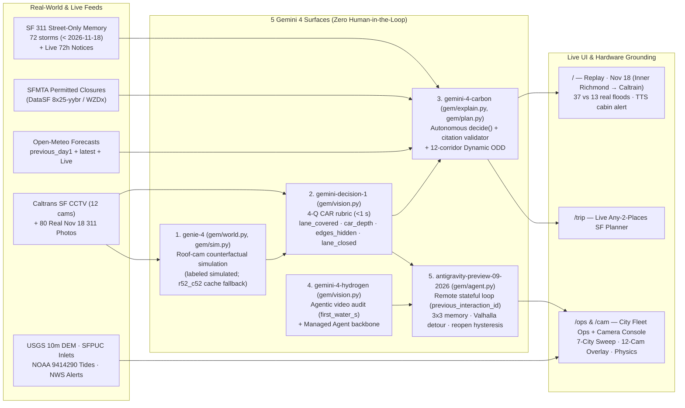

# Robotaxi Flood Pull-Back

> **Autonomous Dynamic ODD (ISO 34503) for robotaxi fleets: zero human-in-the-loop.**  
> *"Before pickup and while driving, the car looks four blocks and twenty minutes ahead—combining street-only flood memory, SFMTA permitted lane closures, Genie 4 roof-camera simulation, Decision 1 CAR scoring, Gemini 4 Carbon decisions, and Antigravity Managed Agents."*
>
> **Gemini 4 NYC Hackathon** · November 21, 2026 · **Track:** Antigravity Managed Agents ($5k Prize) + Full 5-Surface Gemini 4 Stack

---

## 1. Elevator Pitch & Problem Statement

On **Wednesday, November 18, 2026**, San Francisco experienced a historic atmospheric river:
- **Nov 11 / 17 (Freeway ban):** The California DMV restricted driverless cars from state freeways following construction-zone incidents (with two Waymo recalls filed Nov 19–20)—forcing **100% of SF trips onto surface arterials**.
- **Nov 18 rainfall records:** Downtown SF recorded **2.11"** before noon (wettest pre-noon in **76 years**, breaking 1950) and **2.64"** storm total (breaking the **108-year** Nov 18 daily record).
- **Record street flooding:** Residents logged **778 flood reports** to SF 311 (`vw6y-z8j6`, split into **691 street** vs **87 property/basement**)—the highest single-day total on record, with **384 reports in the 10:00 AM hour alone**.
- **23-hour citywide Waymo pause:** After 5+ vehicles stalled in standing water (including **Oak & Cole**, **Fell & Masonic**, and **Bayshore & Industrial**), Waymo paused SF/Bay Area service from **~11:00 AM Nov 18 to ~10:00 AM Nov 19**—costing an estimated **$607K–$629K in lost fares** plus **$50K–$190K+** in recovery/write-off risk (`research/BUSINESS_CASE_AND_EXPANSION.md`).
- **Public regulatory ground truth (`data/waymo_stats.json`, `data/waymo_sf.geojson`):**
  - **CPUC Waymo 2026 Q3 filing** (ended Sep 30, 2026—strictly pre-Nov-18): **65 of 244 SF census tracts (27%)** recorded Waymo collisions (94 Q3 collisions), and **374 of 778 Nov 18 floods (48.1%)** occurred inside those 65 Waymo-active tracts.
  - **NHTSA SGO (Jun 2025 – Oct 2026):** **402** Waymo SF crash reports, **16 in rain**.

**Robotaxi Flood Pull-Back** replaces binary citywide shutdowns with a **zero-human-in-the-loop Dynamic ODD** system:
1. **Two-decision autonomous ride (`/`, Replay · Nov 18):** Before pickup (`08:58`), Gemini 4 Carbon inspects street-only 311 flood memory + the night-before forecast (`previous_day1`) and picks a flood-aware route (`+0.5 min`). Three minutes into the ride, a newer forecast arrives (`8.6 mm/h`), flagging **Grove & Van Ness** (`8` past storm floods + **`5` active SFMTA permitted lane closures** nearby). **Genie 4** simulates that street from the robotaxi's roof camera (seeded with a real 311 resident photo), **Decision 1** scores a 4-question CAR rubric (`lane_covered`, `car_depth` vs tire/hub, `edges_hidden`, `lane_closed`), and **Gemini 4 Carbon** reroutes mid-ride without stopping—cutting real 9 AM–noon street floods from **37 → 13**.
2. **Live any-two-places trip planner (`/trip`, Plan a trip · live):** Enter *any* two SF places (or 1-click presets). Geocodes via OSM Nominatim, routes surface-streets-only, scans **last-72h 311 flood notices + tonight's Open-Meteo forecast + live SFMTA lane closures + live Caltrans cameras**, simulates the worst spot with Genie 4, and lets Carbon make the final autonomous call.
3. **City-wide Ops & Fleet-Camera Managed Agent (`/ops`, `/cam`):** Pre-storm Carbon corridors (8.0% of SF) + real-time **Antigravity Managed Agents (`antigravity-preview-09-2026`)** closing unzoned flash floods (e.g., `691 2nd St` real Waymo flood photo) fleet-wide with live Valhalla detour budgeting (`+1.19 min`) and 2-frame reopen hysteresis.

---

## 2. System Architecture (All 5 Gemini 4 Surfaces + Grounded Physics)



---

## 3. Why Antigravity Managed Agents ($5k Prize Track)

A brittle `if flooded: block_cell()` script either under-blocks one 165 m cell (leaving adjacent flooded cross-streets open) or over-blocks dry arterials. `gem/agent.py` runs **Antigravity Managed Agents (`antigravity-preview-09-2026`)** on `v1beta` Interactions (`environment="remote"`, `previous_interaction_id`):
- **Autonomous incident loop (`run_incident`, ~19–25 s):** Chains `get_cell_history(3×3)` + `get_forecast(date)` + **`estimate_fleet_detour(cells)`** (live Valhalla routing proving `+1.19 min, +0.39 km` impact) → `propose_zone` (hard-bounded to Chebyshev ≤ 2 and clamped to `23:59`, stamped with `agent_engine` + `interaction_id`).
- **Autonomous ride agent (`run_ride`, 19.4 s live / 0.51 s replay):** Accepts v2 `plan + check + SFMTA closures`, verified live in 5 steps (`media/traces/ride_2026-11-18.json`).
- **Autonomous reopen hysteresis (`check_reopen`):** Requires 2 consecutive dry/low-water frames (`flooded_p < 0.30`) + easing forecast before reopening a corridor—preventing oscillation.

---

## 4. Honest, Leakage-Free Evaluation Results

| Benchmark / Surface | Verified Result | Anti-Leakage / Control |
|---|---|---|
| **Nov 18 Replay Ride (`/` — Inner Richmond → Caltrain)** | **37 real 311 street floods** on fastest route vs **13** on W-112's autonomous route | Flood history `< 2026-11-18`; `previous_day1` + `latest` forecasts; 311 reports used *only* after arrival to score |
| **15-Storm Leave-One-Storm-Out Backtest (`media/backtest.json`)** | **44.8%** flood recall at **8.1%** of SF area (vs **42.9%** baseline, wins 13/15, loses 0; **5.7×** over **7.9%** random) | Strict temporal holdout: every storm scored using *only* prior storms |
| **Waymo Active Tracts on Nov 18 (CPUC Q3, 65 tracts)** | **50.9%** caught by Carbon zones (vs **46.5%** baseline) in **8.0%** of SF | CPUC Q3 ended Sep 30, 2026 (7 weeks pre-storm) |
| **Real Rain False-Positive Control (Waymo Open Dataset)** | **Decision 1:** `0.22–0.30` (`p_tire=0.04` → **`proceed`**); **Hydrogen video:** `0.05` (`first_water_s: null`) | Real SF rainy freeway frames (git-ignored, not redistributed) |
| **Live 12-Camera SF Caltrans Sweep (`gem/cctv.py`)** | **12 live cameras** scanned in **2.03 s**, **0 false alarms** | Real Caltrans District 4 feeds (`media/cctv_sweep.json`) |
| **Live 7-City US AV Portability (`gem/cities.py`)** | **7 metros** (SF, Austin, Miami, Atlanta, San Antonio, Phoenix, NYC) checked in **0.21 s** | Live NWS API: catches active **SF Coastal Flood Warning (`PULLBACK_ACTIVE`)** |
| **Physics & Hydrology Grounding (`gem/physics.py`, `gem/terrain.py`)** | 1550 nm LiDAR `>99.99%` absorbed at 10 mm water; I-PACE sidewall `4.82 in`; **Nov 25 King Tide `7.03 ft` Golden Gate → `7.53 ft` Mission Creek** | USGS 10m DEM + SFPUC inlets + NOAA `9414290` + NWS alerts (`0.48 ms`) |
| **In-Cabin & Dispatch Audio (`gem/voice.py`)** | `gemini-3.8-flash-lite-tts` WAV alerts generated in **1.12–1.39 s** | Wired into `/` cabin voice button & `/ops` Alert button (`media/audio/`) |

---

## 5. Quickstart & 3-Minute Stage Walkthrough (`DEMO.md`)

```bash
python3 -m venv .venv
.venv/bin/pip install google-genai python-dotenv pillow pydantic
echo "GEMINI_API_KEY=your-key" > .env
.venv/bin/python server.py
```

### Live URLs
- **Primary Demo — Nov 18 Autonomous Replay:** `http://localhost:8000` (`/`)
- **Live Any-2-Places SF Trip Planner:** `http://localhost:8000/trip`
- **City-Wide Fleet Ops Console (Nov 18 Replay + Nov 25 Live King Tide + 12 Cams + 7 Cities):** `http://localhost:8000/ops`
- **Fleet Camera & Antigravity Managed Agent Console:** `http://localhost:8000/cam`

See [`DEMO.md`](../DEMO.md) for the exact word-for-word 3-minute 2-page stage script and [`research/README.md`](README.md) for all 10 supporting research & validation briefs.
